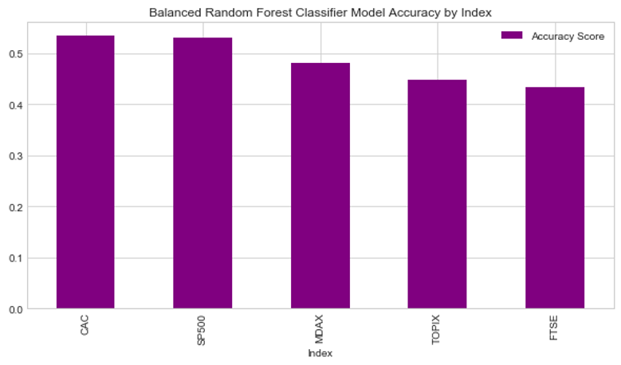
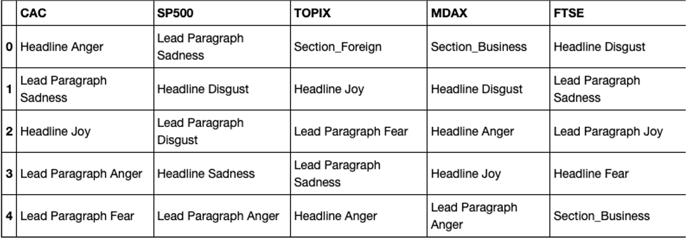
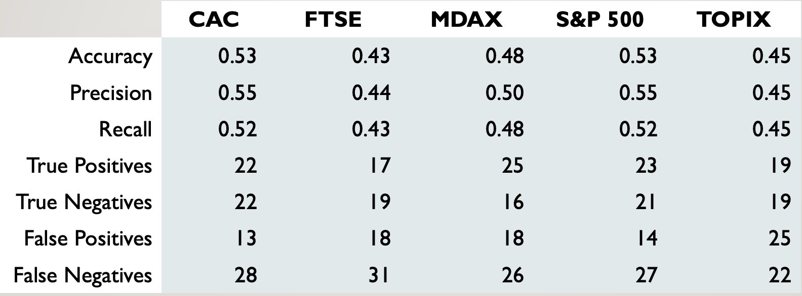
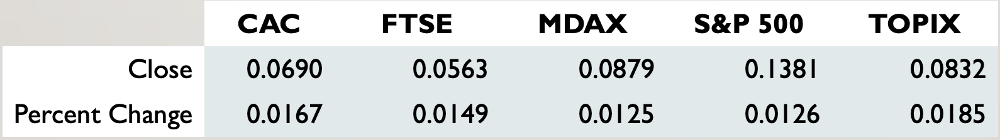
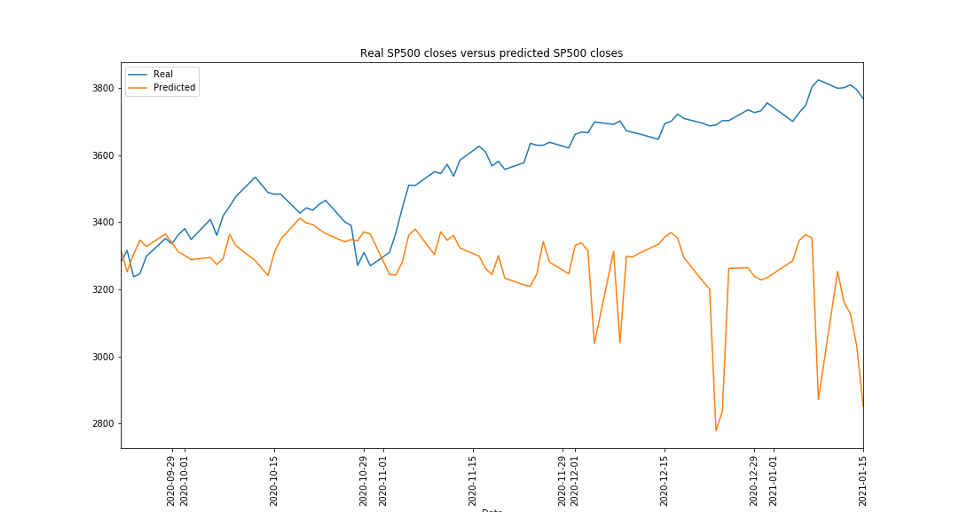
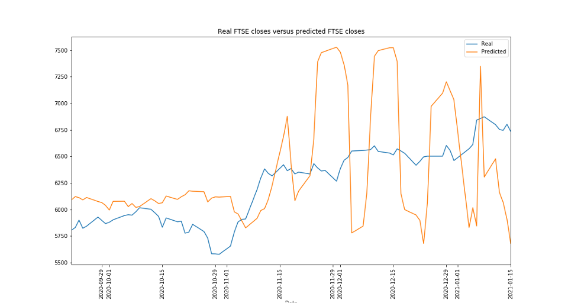
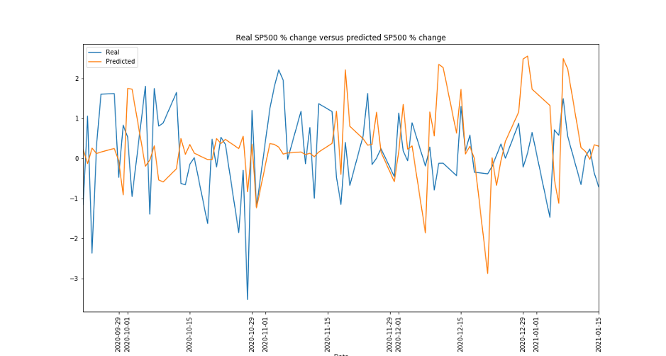
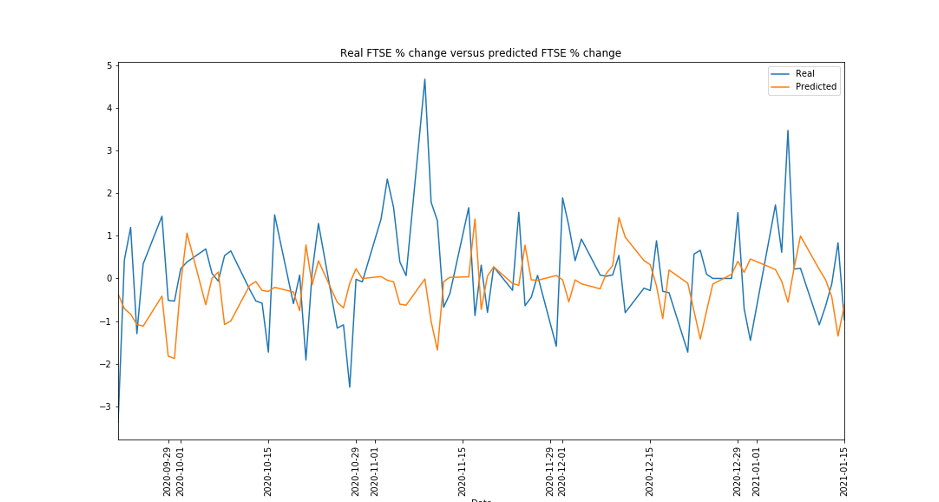

# U.S. News vs. Global Stock Markets - Predicting Global Markets Based on U.S. News Sentiment

This repository explores whether sentiment and emotions in U.S. news headlines can predict daily movements in major global stock indices. Natural language processing is used to score New York Times articles and those scores feed a set of machine learning models.

## Project Overview
- Collect 90 days of New York Times headlines and global index prices
- Score each article using IBM Watson Natural Language Understanding
- Train models (Balanced Random Forest classifier and LSTM neural network) to forecast index direction and percentage change

## Research Questions
- How do global markets fluctuate based on U.S. news sentiment?
- Can we predict daily percent change for the S&P 500 (USA), FTSE 100 (UK), CAC 40 (France), DAX (Germany), and TOPIX (Japan)?
- How are major global markets expected to perform over the next five days?

## Data Sources
- [New York Times APIs](https://developer.nytimes.com/apis)
- Google Finance: global indices stock prices

## Repository Structure
- `data_fetching.ipynb` – pull NYT news and market data
- `ibm_watson.ipynb` – run sentiment and emotion analysis
- `machine_learning.ipynb` / `machine_learning-LSTM.ipynb` – build predictive models
- `data/` – CSV files and visualizations

## Evaluation Metrics

### Balanced Random Forest: Accuracy by Index

### Top Five Emotions (by Index)

### Classification Model

### Log-cosh

### Mean Squared Error

## Results: Close Price (LSTM Model)

### S&P 500 (US)

### FTSE (UK)

## Results: Percent Change (LSTM Model)

### S&P 500 (US)

### FTSE (UK)

## Natural Language Processing (Word Cloud)

## Machine Learning Models & NLP Kits
- [IBM Watson Natural Language Understanding](https://www.ibm.com/cloud/watson-natural-language-understanding)
- LSTM model
- Balanced Random Forest classifier

## Conclusion / Postmortem
- New York Times headlines and lead paragraphs skewed heavily negative.
- We observed little correlation between U.S. news sentiment and global stock index movements.
- The top five emotions across indices were largely negative, which may reflect the period studied (10/13 – 1/13).
- Incorporating additional news sources like Bloomberg, CNBC or the Wall Street Journal could provide more balanced sentiment.

## Task Breakdown
- Fetch 90 days of closing price data for global indices using the Quandl API.
- Fetch 90 days of news data.
- Perform sentiment analysis with IBM Watson.
- Build, fit, and evaluate machine learning models to generate predictions.
